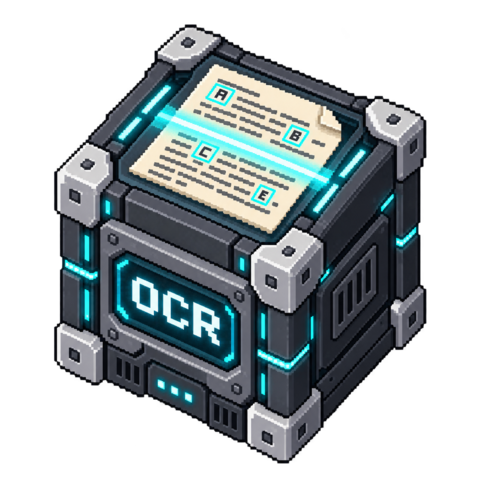

# OCR

<!-- block-metadata:start -->

Verified BloxSmith versions: **1.0.9** (bundled-block tests; see [test evidence](compatibility.json)).
<!-- block-metadata:end -->

Recognize text from local images and scanned PDF pages using Tesseract. The original
is never modified or uploaded. Outputs preserve a source SHA-256, page numbers,
word positions and engine confidence for review.

## Ports

| Direction | Port | Payload |
| --- | --- | --- |
| Input | `document` | Local file path or `{"path":"scan.pdf"}` |
| Output | `text` | Recognized text, with page separators |
| Output | `pages` | Source reference, engine, partial flag and per-page text/word boxes |
| Output | `issues` | Source reference, partial/review flags and review issues |

`box` is `[left, top, width, height]` in processed image pixels. PDF pages are rasterized;
these are not PDF-point coordinates. Word references include block, paragraph and line.
All selected pages complete before outputs are emitted. Failures and cancellation emit
no partial output. Recognized pages with low-confidence words or no detected text are
instead successful results explicitly marked `partial`; all detected words remain in `text`.
A blank page is not proof of an unreadable page, and unrecognized regions cannot be
reliably localized. The `no_text_detected` issue covers the whole page.

## Requirements

- Tesseract 5 with every selected language pack installed (for example `eng`, `fra`).
- Python Pillow for bounded image decoding and white-background normalization.
- Poppler `pdfinfo` and `pdftoppm` for PDF inputs only.

Tools must be on the runtime PATH. The block never installs binaries, downloads models,
or contacts a provider. The CLI uses the documented [Tesseract TSV output](https://tesseract-ocr.github.io/tessdoc/Command-Line-Usage.html#tsv-output)
to retain word coordinates and confidence. Confidence is an engine score, not a calibrated
probability or a guarantee that a name, number or amount is correct.

## Settings

The modal and inspector share the same configuration and explicit Apply action.

- `allowed_root`: read boundary; empty means the runtime working directory.
- `languages`: ordered JSON array of installed codes; default `["eng"]`.
- `first_page`, `last_page`: PDF selection, 1-based; `0` for the last page.
- `confidence_threshold`: flag words below this score without discarding them.
- Advanced: `dpi`, `page_segmentation`, `max_pages`, `max_bytes`,
  `max_characters`, `timeout_sec`.

Supported images: PNG, JPEG, single-page TIFF, WebP, BMP and PPM. Animated and multi-frame
images are refused. PDF rendering respects requested DPI unless a page must be reduced
to fit 4096 pixels per side, in which case an issue is returned. Image files larger than
that limit are refused; resize a copy upstream. Transparency is flattened onto white.
There is no automatic orientation correction, deskewing, handwriting model, remote
engine or searchable-PDF generation in this version. Page segmentation is configurable
without changing document pixels.

## Limits and trust boundary

At most 100 selected pages, 50 MiB of source, 1 million recognized characters,
4096 pixels per side, 50,000 words per page, 6 MiB of combined page/issue metadata,
and 600 seconds per document. Defaults are lower. Child output is bounded and children
are terminated on timeout/cancellation. Sources are copied into private temporary files
and changes during the copy are refused. Temporary files are cleaned on completion.
Read-path checks and application limits are not an OS memory sandbox; process only
trusted files or deploy the runtime inside an appropriate isolation boundary.

Runtime logs contain counts and sanitized diagnostics, not recognized text. Outputs do
contain source paths and document contents; connect them only to intended consumers.

## Tests

The package owns functional tests with real Tesseract/Poppler, both-runtime and
managed/linked integration tests, and browser tests for Apply, Cancel, translated
labels, inspector drafts and 320–1440 px layouts. Test fixtures are generated locally;
the private BloxSmith test harness is not distributed with this package.

## License

Apache-2.0. External tools, models and their licenses are separate dependencies.
